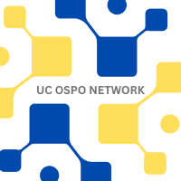

```{=html}
<style>
.handout {
  --navy: #1f335e; --blue: #003cb3; --orange: #ff9100; --muted: #f0f4fa;
  --border: #c6d2e8; --text: #222832; --small: #555;
  font-size: 9pt; line-height: 1.4; color: var(--text);
  zoom: 1.3;
  margin-top: 1em;
}
.handout * { margin: 0; padding: 0; box-sizing: border-box; }
.handout h1 { border: none; }
.handout .handout-header {
  display: flex;
  align-items: center;
  gap: 0.9em;
  padding-bottom: 0.45em;
  border-bottom: 3px solid var(--orange);
  margin-bottom: 0.6em;
}
.handout .handout-header img { height: 36px; width: auto; flex-shrink: 0; }
.handout .handout-header-text h1 {
  font-size: 13pt;
  font-weight: 700;
  color: var(--navy);
  line-height: 1.2;
  margin: 0;
}
.handout .handout-header-text p {
  font-size: 8pt;
  color: var(--small);
  margin-top: 0.1em;
}
.handout .handout-body {
  display: grid;
  grid-template-columns: 55% 1fr;
  gap: 1.2em;
}
.handout .section-label {
  font-size: 7.5pt;
  font-weight: 700;
  letter-spacing: 0.09em;
  text-transform: uppercase;
  color: var(--navy);
  border-bottom: 2px solid var(--navy);
  padding-bottom: 0.18em;
  margin-bottom: 0.45em;
}
.handout .timeline {
  position: relative;
  display: block;
}
.handout .timeline::before {
  content: '';
  position: absolute;
  left: 2.8em;
  top: 0;
  bottom: 0;
  width: 1.5px;
  background: var(--border);
  z-index: 0;
}
.handout .era-label {
  display: block;
  font-size: 6pt;
  font-weight: 700;
  text-transform: uppercase;
  letter-spacing: 0.1em;
  color: var(--orange);
  padding: 0.42em 0 0.16em 3.5em;
  position: relative;
  z-index: 1;
}
.handout .era-label:first-child {
  padding-top: 0;
}
.handout .tl-entry {
  display: grid;
  grid-template-columns: 2.1em 0.9em 1fr;
  gap: 0 0.25em;
  align-items: start;
  margin-bottom: 0.33em;
  position: relative;
  z-index: 1;
}
.handout .tl-year {
  font-size: 6pt;
  font-weight: 700;
  color: #999;
  text-align: right;
  padding-top: 0.15em;
  line-height: 1.2;
}
.handout .tl-dot-col {
  display: flex;
  justify-content: center;
  padding-top: 0.22em;
}
.handout .tl-dot {
  width: 7px;
  height: 7px;
  border-radius: 50%;
  background: var(--orange);
  border: 1.5px solid #fff;
  flex-shrink: 0;
}
.handout .tl-body { min-width: 0; }
.handout .tl-name-row {
  display: flex;
  align-items: baseline;
  gap: 0.4em;
  flex-wrap: wrap;
  margin-bottom: 0.04em;
}
.handout .tl-name {
  font-weight: 700;
  color: var(--navy);
  font-size: 8.5pt;
}
.handout .tl-origin {
  font-size: 6.5pt;
  color: var(--small);
}
.handout .tl-desc {
  font-size: 8pt;
  line-height: 1.36;
}
.handout .tl-link {
  font-size: 7pt;
  color: var(--blue);
  text-decoration: none;
  margin-left: 0.3em;
  white-space: nowrap;
}
.handout .tl-link:hover { color: var(--orange); }
.handout .also-list {
  display: flex;
  flex-wrap: wrap;
  gap: 0.28em;
  margin-top: 0.38em;
}
.handout .also-badge {
  background: var(--muted);
  border: 1px solid var(--border);
  border-radius: 3px;
  padding: 0.12em 0.4em;
  font-size: 7.5pt;
  color: var(--navy);
  font-weight: 600;
  white-space: nowrap;
}
.handout .right-col { display: flex; flex-direction: column; gap: 0.6em; }
.handout .panel { border: 1px solid var(--border); border-radius: 5px; overflow: hidden; }
.handout .panel-head {
  background: var(--navy);
  color: #fff;
  font-size: 7.5pt;
  font-weight: 700;
  letter-spacing: 0.07em;
  text-transform: uppercase;
  padding: 0.28em 0.55em;
}
.handout .panel-body { padding: 0.45em 0.55em; background: #fff; }
.handout .panel-body p, .handout .panel-body li { font-size: 8.5pt; line-height: 1.38; }
.handout .stat-row { display: flex; align-items: baseline; gap: 0.35em; margin-bottom: 0.25em; }
.handout .stat-num { font-size: 15pt; font-weight: 700; color: var(--orange); line-height: 1; }
.handout .stat-label { font-size: 8pt; color: var(--text); line-height: 1.3; }
.handout .stat-divider { border: none; border-top: 1px solid var(--border); margin: 0.3em 0; }
.handout .campus-chips { display: flex; flex-wrap: wrap; gap: 0.22em; margin-top: 0.22em; }
.handout .campus-chip {
  background: var(--orange);
  color: #fff;
  border-radius: 3px;
  padding: 0.1em 0.38em;
  font-size: 7pt;
  font-weight: 700;
}
.handout .area-row { display: flex; gap: 0.3em; margin-bottom: 0.18em; }
.handout .area-icon { color: var(--orange); flex-shrink: 0; }
.handout .area-text { font-size: 8.5pt; }
.handout .area-text strong { color: var(--navy); }
.handout .resource-row { display: flex; align-items: center; gap: 0.38em; margin-bottom: 0.18em; font-size: 8.5pt; }
.handout .resource-file {
  font-family: "SFMono-Regular", Consolas, monospace;
  font-size: 7.5pt;
  background: var(--muted);
  color: var(--navy);
  border-radius: 2px;
  padding: 0.08em 0.28em;
  white-space: nowrap;
  flex-shrink: 0;
}
.handout a.resource-file {
  text-decoration: underline;
  text-underline-offset: 2px;
}
.handout a.resource-file:hover { color: var(--blue); }
.handout .learn-link { display: block; font-size: 8.5pt; font-weight: 700; color: var(--blue); text-decoration: none; margin-bottom: 0.18em; }
.handout .learn-link:hover { color: var(--orange); }
.handout .handout-footer {
  margin-top: 0.55em;
  padding-top: 0.35em;
  border-top: 1px solid var(--border);
  font-size: 7pt;
  color: var(--small);
  display: flex;
  justify-content: space-between;
}
@media (max-width: 700px) {
  .handout { zoom: 1.15; }
  .handout .handout-body { grid-template-columns: 1fr; }
}
@page { size: letter; margin: 0.4in 0.5in; }
@media print {
  #quarto-header, .nav-footer, #title-block-header, .quarto-title-banner { display: none !important; }
  main.content, #quarto-content, #quarto-document-content { margin: 0 !important; padding: 0 !important; min-height: 0 !important; }
  body { padding: 0 !important; margin: 0 !important; }
  #quarto-appendix, .quarto-appendix, #quarto-margin-sidebar, #quarto-sidebar { display: none !important; }
  .handout { zoom: 0.86; margin: 0; }
  .handout a { color: var(--blue) !important; }
}
</style>

<div class="handout">

<div class="handout-header">
  
  <div class="handout-header-text">
    <h1>UC Open Source as Institutional Infrastructure</h1>
    <p>UC OSPO Network &middot; ucospo.net</p>
  </div>
</div>

<div class="handout-body">

<div class="left-col">

<div class="section-label">From Dissertation to Global Infrastructure</div>

<div class="timeline">

  <div class="era-label">Open Source Foundation</div>

  <div class="tl-entry">
    <div class="tl-year">1973</div>
    <div class="tl-dot-col"><div class="tl-dot"></div></div>
    <div class="tl-body">
      <div class="tl-name-row">
        <span class="tl-name">INGRES / PostgreSQL</span>
        <span class="tl-origin">UC Berkeley</span>
      </div>
      <div class="tl-desc">Stonebraker and Wong built INGRES and released the code freely. It seeded Sybase and, indirectly, Microsoft SQL Server. Stonebraker's follow-on POSTGRES (1986) pioneered object-relational databases; volunteers turned it into <strong>PostgreSQL</strong>, now one of the most widely used open source databases. <a class="tl-link" href="https://www.postgresql.org">postgresql.org &rarr;</a></div>
    </div>
  </div>

  <div class="tl-entry">
    <div class="tl-year">1977</div>
    <div class="tl-dot-col"><div class="tl-dot"></div></div>
    <div class="tl-body">
      <div class="tl-name-row">
        <span class="tl-name">BSD Unix</span>
        <span class="tl-origin">UC Berkeley</span>
      </div>
      <div class="tl-desc">The Berkeley Software Distribution and its permissive license. BSD-style licenses, along with MIT and Apache, now govern much of the world's production software. <a class="tl-link" href="https://www.mckusick.com/history/index.html">history &rarr;</a></div>
    </div>
  </div>

  <div class="era-label">Universal Infrastructure</div>

  <div class="tl-entry">
    <div class="tl-year">1986</div>
    <div class="tl-dot-col"><div class="tl-dot"></div></div>
    <div class="tl-body">
      <div class="tl-name-row">
        <span class="tl-name">tz database</span>
        <span class="tl-origin">UCLA (Paul Eggert)</span>
      </div>
      <div class="tl-desc">The Time Zone Database keeps the world's computer clocks on civil time. Paul Eggert of UCLA has contributed since 1991, maintained it since 2005, and served as the IANA Time Zone Coordinator since 2012. A 2011 copyright lawsuit briefly threatened it; IANA has hosted it since. <a class="tl-link" href="https://www.iana.org/time-zones">iana.org/time-zones &rarr;</a></div>
    </div>
  </div>

  <div class="era-label">Open Science</div>

  <div class="tl-entry">
    <div class="tl-year">2000</div>
    <div class="tl-dot-col"><div class="tl-dot"></div></div>
    <div class="tl-body">
      <div class="tl-name-row">
        <span class="tl-name">UCSC Genome Browser</span>
        <span class="tl-origin">UC Santa Cruz</span>
      </div>
      <div class="tl-desc">Jim Kent wrote the program that assembled the first public draft of the human genome, and the sequence stayed in the public domain. The browser is now a reference tool for genomic research worldwide. <a class="tl-link" href="https://genome.ucsc.edu">genome.ucsc.edu &rarr;</a></div>
    </div>
  </div>

  <div class="era-label">Scientific Computing &amp; Domain Science</div>

  <div class="tl-entry">
    <div class="tl-year">2001</div>
    <div class="tl-dot-col"><div class="tl-dot"></div></div>
    <div class="tl-body">
      <div class="tl-name-row">
        <span class="tl-name">Jupyter</span>
        <span class="tl-origin">UC Berkeley</span>
      </div>
      <div class="tl-desc">Fernando P&eacute;rez wrote the first IPython as a graduate student. Project Jupyter won the 2017 ACM Software System Award. P&eacute;rez is a co-PI on the UC OSPO Network. <a class="tl-link" href="https://jupyter.org">jupyter.org &rarr;</a></div>
    </div>
  </div>

  <div class="tl-entry">
    <div class="tl-year">2001</div>
    <div class="tl-dot-col"><div class="tl-dot"></div></div>
    <div class="tl-body">
      <div class="tl-name-row">
        <span class="tl-name">EEGLAB</span>
        <span class="tl-origin">UC San Diego</span>
      </div>
      <div class="tl-desc">An open source environment for processing electrophysiological signals, with one of the largest citation footprints of any scientific software. <a class="tl-link" href="https://sccn.ucsd.edu/eeglab/">eeglab &rarr;</a></div>
    </div>
  </div>

  <div class="tl-entry">
    <div class="tl-year">2003</div>
    <div class="tl-dot-col"><div class="tl-dot"></div></div>
    <div class="tl-body">
      <div class="tl-name-row">
        <span class="tl-name">Cytoscape</span>
        <span class="tl-origin">UC San Diego</span>
      </div>
      <div class="tl-desc">A standard tool for network biology: disease pathways, protein interactions, and molecular networks. <a class="tl-link" href="https://cytoscape.org">cytoscape.org &rarr;</a></div>
    </div>
  </div>

  <div class="era-label">Infrastructure at Scale</div>

  <div class="tl-entry">
    <div class="tl-year">2004</div>
    <div class="tl-dot-col"><div class="tl-dot"></div></div>
    <div class="tl-body">
      <div class="tl-name-row">
        <span class="tl-name">Ceph</span>
        <span class="tl-origin">UC Santa Cruz</span>
      </div>
      <div class="tl-desc">Sage Weil&rsquo;s PhD research on exabyte-scale distributed storage. Its client merged into the Linux kernel in 2010, and money from Ceph&rsquo;s commercialization funded <strong><abbr title="Center for Research in Open Source Software">CROSS</abbr></strong> at UCSC, the seed of this network. <a class="tl-link" href="https://ceph.io">ceph.io &rarr;</a></div>
    </div>
  </div>

  <div class="tl-entry">
    <div class="tl-year">2009</div>
    <div class="tl-dot-col"><div class="tl-dot"></div></div>
    <div class="tl-body">
      <div class="tl-name-row">
        <span class="tl-name">Apache Spark</span>
        <span class="tl-origin">UC Berkeley AMPLab</span>
      </div>
      <div class="tl-desc">Matei Zaharia&rsquo;s fast cluster computing engine, donated to the Apache Software Foundation and now an industry standard for large-scale data processing. <a class="tl-link" href="https://spark.apache.org">spark.apache.org &rarr;</a></div>
    </div>
  </div>

  <div class="tl-entry">
    <div class="tl-year">2010</div>
    <div class="tl-dot-col"><div class="tl-dot"></div></div>
    <div class="tl-body">
      <div class="tl-name-row">
        <span class="tl-name">RISC-V</span>
        <span class="tl-origin">UC Berkeley</span>
      </div>
      <div class="tl-desc">An open instruction set that began as a summer project. RISC-V International has member organizations in 70 countries. <a class="tl-link" href="https://riscv.org">riscv.org &rarr;</a></div>
    </div>
  </div>

  <div class="tl-entry">
    <div class="tl-year">2010</div>
    <div class="tl-dot-col"><div class="tl-dot"></div></div>
    <div class="tl-body">
      <div class="tl-name-row">
        <span class="tl-name">Named Data Networking</span>
        <span class="tl-origin">UCLA &middot; Lixia Zhang, Lead PI</span>
      </div>
      <div class="tl-desc">Zhang was the only woman at the first <abbr title="Internet Engineering Task Force">IETF</abbr> meeting in 1986. NDN rethinks internet architecture around named data instead of host addresses. <a class="tl-link" href="https://named-data.net">named-data.net &rarr;</a></div>
    </div>
  </div>

  <div class="era-label">AI Infrastructure</div>

  <div class="tl-entry">
    <div class="tl-year">2016</div>
    <div class="tl-dot-col"><div class="tl-dot"></div></div>
    <div class="tl-body">
      <div class="tl-name-row">
        <span class="tl-name">Ray</span>
        <span class="tl-origin">UC Berkeley RISELab</span>
      </div>
      <div class="tl-desc">A framework for scaling Python and AI workloads, now used to train and serve large models in industry. <a class="tl-link" href="https://ray.io">ray.io &rarr;</a></div>
    </div>
  </div>

</div>

<div style="margin-top:0.42em;">
  <div class="section-label" style="font-size:7pt;">Also from UC campuses</div>
  <div class="also-list">
    <span class="also-badge">Processing (UCLA)</span>
    <span class="also-badge">UCSD Pascal</span>
    <span class="also-badge">ChimeraX (UCSF)</span>
    <span class="also-badge">OpenMM</span>
    <span class="also-badge">sourmash (UC Davis)</span>
    <span class="also-badge">ERPLAB (UC Davis)</span>
  </div>
</div>

</div>

<div class="right-col">

  <div class="panel">
    <div class="panel-head">The UC OSPO Network</div>
    <div class="panel-body">
      <div class="stat-row">
        <div class="stat-num">8</div>
        <div class="stat-label">member campuses in 2026<br>launched in 2024 with six, with support from the Alfred P. Sloan Foundation</div>
      </div>
      <hr class="stat-divider">
      <div class="campus-chips">
        <span class="campus-chip">Berkeley</span>
        <span class="campus-chip">Davis</span>
        <span class="campus-chip">Los Angeles</span>
        <span class="campus-chip">San Diego</span>
        <span class="campus-chip">San Francisco</span>
        <span class="campus-chip">Santa Barbara</span>
        <span class="campus-chip">Santa Cruz</span>
        <span class="campus-chip">UC Law SF</span>
      </div>
      <p style="font-size:7.5pt; color:#777; margin-top:0.3em;">Led from UC Santa Cruz. Part of <strong><abbr title="Community for University and Research Institution OSPOs">CURIOSS</abbr></strong>, the global community of academic OSPOs.</p>
    </div>
  </div>

  <div class="panel">
    <div class="panel-head">What We Found</div>
    <div class="panel-body">
      <div class="stat-row">
        <div class="stat-num">52K</div>
        <div class="stat-label">institutionally affiliated repositories found across 10 UC campuses</div>
      </div>
      <hr class="stat-divider">
      <div class="stat-row">
        <div class="stat-num">58%</div>
        <div class="stat-label">of surveyed UC <abbr title="Open Source Software">OSS</abbr> contributors also <em>maintain</em> projects</div>
      </div>
      <hr class="stat-divider">
      <p style="font-size:8.5pt; margin-bottom:0.18em;"><strong>Top challenge:</strong> time to write documentation</p>
      <p style="font-size:8.5pt;"><strong>Nationally (Tidelift 2024):</strong> 60% of maintainers unpaid &middot; 43% burned out</p>
    </div>
  </div>

  <div class="panel">
    <div class="panel-head">Why It Matters: The Economics</div>
    <div class="panel-body">
      <div class="stat-row">
        <div class="stat-num">$8.8T</div>
        <div class="stat-label">demand-side value of open source software to the firms that use it</div>
      </div>
      <p style="font-size:7.5pt; color:#777; margin-top:0.2em;">Recreating the most-used packages once would cost about $4.15B. If every firm rebuilt them for itself: about $8.8 trillion. Hoffmann, Nagle &amp; Zhou (2024), <abbr title="Harvard Business School">HBS</abbr> Working Paper 24-038.</p>
    </div>
  </div>

  <div class="panel">
    <div class="panel-head">Three Focus Areas</div>
    <div class="panel-body">
      <div class="area-row">
        <div class="area-icon">&#128301;</div>
        <div class="area-text"><strong>Discovery:</strong> UC Open Repository Browser (UC ORB); a GitHub discovery pipeline and a system-wide survey</div>
      </div>
      <div class="area-row">
        <div class="area-icon">&#127807;</div>
        <div class="area-text"><strong>Sustainability:</strong> cross-campus licensing working group; <abbr title="Open Source PRoject sustainabilitY tracker">OSSPREY</abbr> project health assessment; community management</div>
      </div>
      <div class="area-row">
        <div class="area-icon">&#128214;</div>
        <div class="area-text"><strong>Education:</strong> lessons and learning pathways at ucospo.net/education; Carpentries, CodeRefinery, and UC-built content</div>
      </div>
    </div>
  </div>

  <div class="panel">
    <div class="panel-head">Resources for Researchers</div>
    <div class="panel-body">
      <div class="resource-row"><a class="resource-file" href="https://ucospo.net/oss-resources/template-guides/readme-guide/">README.md</a> template + guide</div>
      <div class="resource-row"><a class="resource-file" href="https://ucospo.net/oss-resources/template-guides/license-guide/">LICENSE</a> guide to common options</div>
      <div class="resource-row"><a class="resource-file" href="https://ucospo.net/oss-resources/template-guides/contributing-guide/">CONTRIBUTING.md</a> template + guide</div>
      <div class="resource-row"><a class="resource-file" href="https://ucospo.net/oss-resources/template-guides/code-of-conduct-guide/">CODE_OF_CONDUCT.md</a> Contributor Covenant</div>
      <div class="resource-row"><a class="resource-file" href="https://ucospo.net/research-software-citable-discoverable/">CITATION.cff</a> + Zenodo &rarr; citable <abbr title="Digital Object Identifier">DOI</abbr></div>
      <p style="font-size:7.5pt; color:#777; margin-top:0.25em;">More at <strong>ucospo.net/oss-resources</strong></p>
    </div>
  </div>

  <div class="panel">
    <div class="panel-head">Learn More</div>
    <div class="panel-body">
      <a class="learn-link" href="https://ucospo.net">ucospo.net</a>
      <a class="learn-link" href="https://ucospo.net/events/">ucospo.net/events</a>
      <a class="learn-link" href="https://ucospo.net/education">ucospo.net/education</a>
      <a class="learn-link" href="https://ucospo.net/network-docs/outputs.html">Talks, lessons, and publications</a>
    </div>
  </div>

</div>

</div>

<div class="handout-footer">
  <span>Gomez et al. (2025) arXiv:2506.18359 &middot; Scarlett et al. (2026) PLOS One, doi:10.1371/journal.pone.0348894 &middot; Tidelift (2024) State of the Open Source Maintainer Report &middot; Hoffmann, Nagle &amp; Zhou (2024) HBS WP 24-038</span>
  <span>UC OSPO Network</span>
</div>

</div>
```
